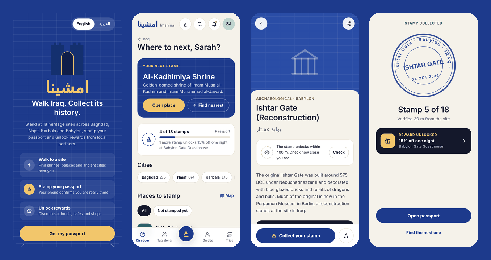
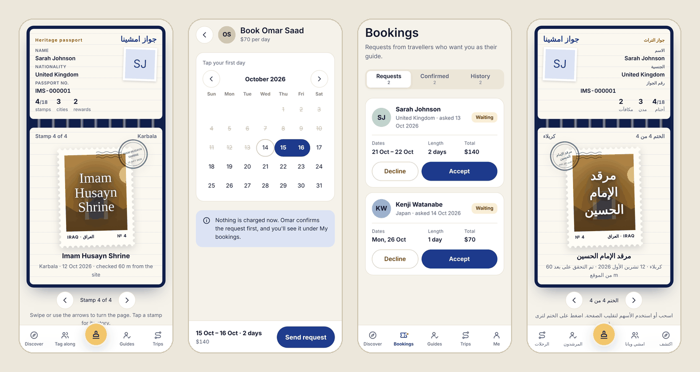
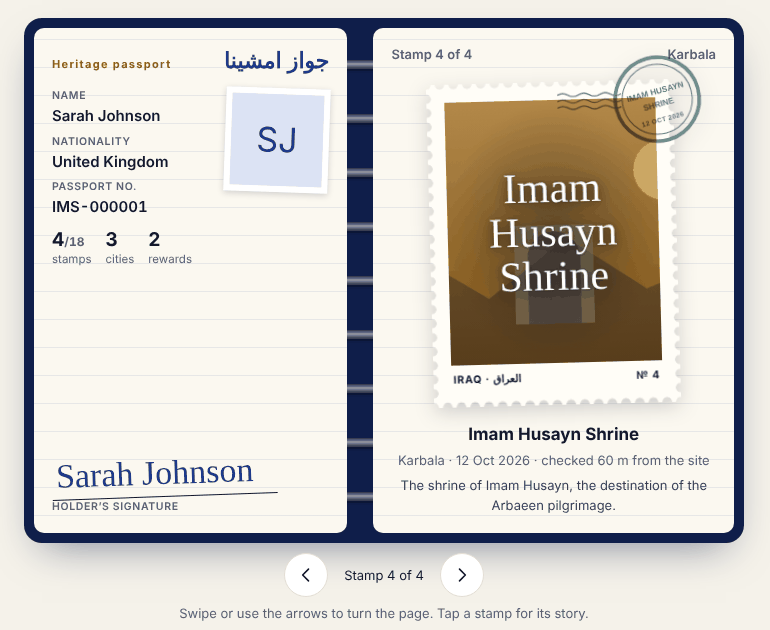
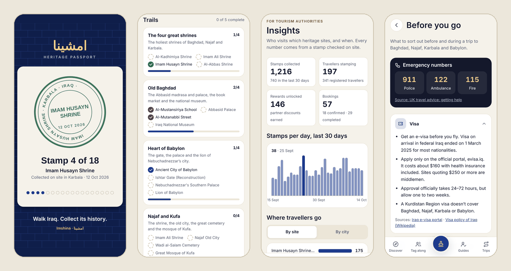

<div align="center">

# Imshina · امشينا

**Walk Iraq. Collect its history.**

A heritage passport for visitors to Iraq. Stand at real sites in Baghdad, Najaf, Karbala and Babylon,<br>
stamp your phone's passport with a GPS-checked photo, and unlock rewards from local businesses.

English and Arabic · phone-first · ASP.NET Core + React

</div>



## Contents
- [What it does](#what-it-does)
- [How a stamp is verified](#how-a-stamp-is-verified)
- [Screens](#screens)
- [Tech stack](#tech-stack)
- [Getting started](#getting-started)
- [Deploying and live demos](#deploying-and-live-demos)
- [Demo accounts](#demo-accounts)
- [Testing the GPS stamp](#testing-the-gps-stamp)
- [Configuration](#configuration)
- [API](#api)
- [Booking rules](#booking-rules)
- [Project structure](#project-structure)
- [Design](#design)
- [Status and known limitations](#status-and-known-limitations)
- [Roadmap](#roadmap)

## What it does

Most travel apps help you plan a trip. Imshina rewards you for actually going. Every heritage site has a stamp zone around it, and you can only collect its stamp while you're standing inside that zone.

**Travellers**
- **Discover** 18 heritage sites across 4 cities, with history timelines, visiting tips, maps and a "find nearest" button.
- **Collect stamps** in a passport that works like a notebook: your details stay on one page, and each stamp gets its own page that turns like paper. A stamp is your own photo framed as a postage stamp, with the place name in script and a postmark in the city's ink. Every photo is taken on site and checked against your distance from the place.
- **Unlock a story** at each site: a surprising fact and one thing to look for while you're standing there. The server only sends it once you hold that place's stamp.
- **Share a stamp** as a story-sized image: the stamp, the place and "5 of 18", ready for Instagram or WhatsApp.
- **Follow trails** such as *Old Baghdad* or *Heart of Babylon*, reach milestones, and earn a shareable certificate for stamping all 18 sites.
- **Unlock rewards** from partner hotels, cafés and shops as the stamp count grows.
- **Book local guides** by the day, or book ready-made trips. Cancel a booking yourself if plans change.
- **Build your own trip** from the places you want to see.
- **Tag along** with other travellers: join women-only, men-only or mixed groups, or host your own and approve who joins.
- **Review** a guide after a completed booking.
- **Updates** for unlocked rewards, booking decisions and group approvals.
- **Before you go:** e-visa, money, SIM cards, shrine dress code, Arbaeen dates and emergency numbers, with sources and the date they were checked.

**Guides**
- A **Bookings** inbox: accept or decline requests, cancel before a tour starts, and mark tours completed so travellers can review them.
- A public profile with languages, cities, price per day and reviews.

**Agencies** host travel groups.

**Admins and tourism authorities**
- **Insights:** stamps per site and city, where travellers come from, stamps per day and the busiest days of the week. Totals only; no traveller's name, email or photo is shown.
- Add new places, with the stamp zone picked on a map or set from where you're standing.

## How a stamp is verified

1. The traveller opens a place and taps **Collect your stamp**. Location is only requested when the traveller asks for it, never in the background.
2. The phone checks the distance to the site and shows whether the traveller is inside the stamp zone (150 m for most places, up to 500 m for large archaeological sites).
3. The traveller takes a photo with the live camera. If the browser can't open the camera, the phone's own camera app is used instead.
4. The photo and coordinates go to the server, which checks the distance again with the Haversine formula. It refuses the stamp if the traveller is too far away or already has that stamp.
5. The stamp lands in the passport, and any reward that just became unlocked is shown straight away.

## Screens



The passport notebook · booking a guide for two days · a guide's booking requests · the passport in Arabic

On wider screens the passport opens as a spread: the holder's page stays put and stamp pages turn.





Share card for Instagram stories · trails · insights for tourism authorities (example numbers) · Before you go

## Tech stack

| Part | Built with |
|---|---|
| API | ASP.NET Core (.NET 10), controllers, JWT bearer auth, BCrypt password hashing |
| Database | SQLite through Entity Framework Core, with migrations and an idempotent seed |
| Web app | React 19, Vite 7, React Router 7, Axios |
| Maps | Leaflet + react-leaflet, CARTO Voyager tiles |
| Languages | English and Arabic, right-to-left layout through CSS logical properties, plurals through `Intl.PluralRules` |

## Getting started

### Prerequisites
- [.NET SDK 10](https://dotnet.microsoft.com/download)
- [Node.js](https://nodejs.org/) 20.19 or newer (Vite 7 needs it), with npm

### 1. Run the API
```bash
cd backend/TourIraq.Api
dotnet run
```
The API starts on **http://localhost:5000**. On every start it applies the database migrations (creating `touriraq.db` the first time) and runs the demo seed, so there's nothing else to set up.

The OpenAPI document is at `http://localhost:5000/openapi/v1.json` in Development.

### 2. Run the web app
In a second terminal:
```bash
cd frontend
npm install
npm run dev
```
Open **http://localhost:5173**. The app talks to `http://localhost:5000/api` by default. To point it somewhere else, copy `.env.example` to `.env` and change `VITE_API_URL`.

In VS Code, the tasks **Run API** and **Run frontend** do the same thing (Terminal → Run Task).

## Deploying and live demos

Phones only allow GPS and the camera on HTTPS, so stamping on a real phone needs the app hosted. The repo includes a `Dockerfile` for the API and a Render Blueprint (`render.yaml`) that deploys both parts. **[docs/DEPLOY.md](docs/DEPLOY.md)** walks through it, including the free-plan caveat.

For a pitch or a hackathon, judges won't be standing at a heritage site, so the API can add a **demo stamp at your venue** from settings alone (`DemoVenue:*`). Present, collect a real GPS-checked stamp on stage, and share the card. The checklist is in DEPLOY.md.

## Demo accounts

The seed creates these accounts for local development. All of them use the password **`Demo@1234`**.

| Role | Email |
|---|---|
| Traveller (female) | `tourist@touriraq.demo` |
| Traveller (male) | `tourist.male@touriraq.demo` |
| Guides | `guide.ali@touriraq.demo` · `guide.zainab@touriraq.demo` · `guide.omar@touriraq.demo` · `guide.noor@touriraq.demo` |
| Agency | `agency@touriraq.demo` |
| Admin | `admin@touriraq.demo` |

In development, the login screen has **Demo traveller** and **Demo guide** buttons that fill these in. Set `VITE_DEMO=true` to show them in a production build too, for example on a demo day.

The demo traveller starts with a few past guide bookings, including one finished booking with Omar Saad that's waiting for a review.

## Testing the GPS stamp

**On a computer:** in Chrome, open DevTools → ⋮ → More tools → **Sensors** → Location → *Other…*, and enter a place's latitude and longitude (or a point about 50 m away). Then open that place, tap **Collect your stamp**, and choose any JPEG or PNG photo. Enter a location far away to see the "too far" screen.

**On a phone:** browsers only share GPS over HTTPS (or on localhost). Put both the web app and the API behind an HTTPS tunnel, for example `cloudflared tunnel --url http://localhost:5173` and the same for port 5000. Then set `VITE_API_URL` to the API's tunnel URL, and add the web app's tunnel address to `Cors:Origins` in `appsettings.json`.

## Configuration

| Setting | Where | What it does |
|---|---|---|
| `Jwt:Key` | `appsettings.Development.json`, user secrets or the `Jwt__Key` environment variable | Signs login tokens. The key in the repo is for local development only. Use a long random value anywhere else. |
| `AdminSetup:Token` | same | Lets the first admin account be created from `/admin/setup`. Change it before deploying, or leave it empty to turn that page off. |
| `Seed:Enabled` | `appsettings.json` | Adds the demo places, accounts and bookings on start. Turn it off for anything public. |
| `Cors:Origins` | `appsettings.json` | Web app addresses allowed to call the API. |
| `ConnectionStrings:DefaultConnection` | `appsettings.json` | SQLite file path. |
| `DemoVenue:Enabled`, `Latitude`, `Longitude`, `RadiusMeters`, `Name`, `NameAr`, `Governorate` | `appsettings.json` or `DemoVenue__…` variables | Adds a stamp place at a demo venue. Turning it off again removes the place and its stamps. |
| `VITE_API_URL` | `frontend/.env` | API base URL, including `/api`. |
| `VITE_DEMO` | `frontend/.env` | `true` shows the demo login buttons outside development. |

For a real deployment, keep secrets out of the repo:
```bash
cd backend/TourIraq.Api
dotnet user-secrets init
dotnet user-secrets set "Jwt:Key" "<a long random string, 32+ characters>"
```

## API

| Method | Endpoint | Who |
|---|---|---|
| POST | `/api/auth/register`, `/api/auth/login` | anyone |
| GET | `/api/governorates`, `/api/governorates/{id}/places?category=` | anyone |
| GET | `/api/places`, `/api/places/{id}` | anyone |
| GET | `/api/places/{id}/story` | traveller holding that place's stamp |
| GET | `/api/guides?language=&governorateId=`, `/api/guides/{id}` | anyone |
| POST | `/api/guides/{id}/reviews` | traveller with a completed booking |
| GET | `/api/trips` | anyone |
| GET / POST | `/api/trips/mine`, `/api/trips/custom` | traveller |
| POST / GET | `/api/bookings`, `/api/bookings/me` | traveller |
| POST | `/api/bookings/{id}/cancel` | traveller (own booking) |
| GET | `/api/guide/bookings` | guide (own bookings) |
| PUT | `/api/guide/bookings/{id}/status` with `Confirmed`, `Cancelled` or `Completed` | guide |
| GET / POST | `/api/groups`, `/api/groups/{id}/join` | anyone / traveller |
| GET / PUT | `/api/groups/{id}/members`, `/api/groups/{id}/members/{userId}` | group host |
| POST | `/api/stamps` (multipart: `placeId`, `lat`, `lng`, `photo`) | traveller |
| GET | `/api/passport/me`, `/api/rewards` | traveller |
| GET / POST | `/api/admin-setup/status`, `/api/admin-setup` | first admin only |
| POST | `/api/admin/places` | admin |
| GET | `/api/admin/insights` | admin (totals only) |

Errors use the standard `ProblemDetails` format. A refused stamp includes `distanceMeters` and `allowedRadiusMeters`, so the app can say how far away the traveller is.

## Booking rules

| Who | Can do | When |
|---|---|---|
| Guide | Accept a request | while it's pending, up to its start date |
| Guide | Decline a request | any time while it's pending |
| Guide | Cancel a confirmed booking | before its start date |
| Guide | Mark a booking completed | from its last day; this unlocks the traveller's review |
| Traveller | Cancel a booking | any time while it's pending, or before the start date once confirmed |

A guide can't be booked for dates that overlap another pending or confirmed booking. Guide bookings can be up to 30 days long, and prices are always calculated on the server.

## Project structure

```
backend/TourIraq.Api/
├── Controllers/   Auth, Places, Governorates, Guides, GuideBookings, Bookings, Trips,
│                  Groups, Stamps, Passport, Rewards, PlaceStories, AdminPlaces,
│                  AdminInsights, AdminSetup
├── Data/          AppDbContext, SeedData (18 places, guides, trips, groups, rewards),
│                  OnSiteStories, DemoVenue
├── DTOs/          request and response shapes (entities are never returned directly)
├── Migrations/    EF Core migrations
├── Models/        entities and enums
└── Services/      JWT, distance (Haversine), file storage, rewards

frontend/src/
├── api/           Axios client and data hooks
├── components/    UI kit, icons, map, calendar, passport stamps
├── context/       auth, language, location, toasts
├── data/          trails and milestones, the "Before you go" facts
├── hooks/         cached queries, updates
├── i18n/          English and Arabic text
├── layouts/       tab bar on phones, side rail on desktop
├── pages/         one file per screen
└── utils/         helpers, share-card drawing

docs/
├── DEPLOY.md      hosting, settings, live demo checklist
├── PLACES.md      how each place's coordinates were checked
├── ROADMAP.md     what's next, and what still needs checking
└── screenshots/
```

## Design

- **Phone first.** People use it standing at a site with a phone in one hand. A bottom tab bar on phones becomes a side rail on wide screens (960 px and up). Tabs change with the account type.
- **Colours** come from the Ishtar Gate's glazed bricks: lapis blue and gold on a warm paper background. Each city has its own stamp ink.
- **Type:** Reem Kufi for headings and IBM Plex Sans Arabic for text. Both cover Arabic and Latin script.
- **Arabic** is a full translation, not an afterthought. The layout mirrors properly, and English names inside Arabic sentences are isolated so the word order stays correct.
- **Fast going back:** a small stale-while-revalidate cache shows the last data instantly and refreshes quietly.
- **Every state is designed:** loading skeletons, empty lists, no connection, location off, too far from the site and already stamped all have their own screens.

All design tokens are in `frontend/src/index.css`, and icons are one inline set in `frontend/src/components/Icon.jsx`.

## Status and known limitations

This is a hackathon MVP, built for the Culture & Tourism Hackathon in Iraq.

- **Not compiled yet:** the newest backend code hasn't been built: the guide booking inbox, traveller cancelling, insights, on-site stories, the demo venue and the coordinate fix. The files are listed in [ROADMAP.md](docs/ROADMAP.md#1-build-and-test-the-backend). None of them change the database schema.
- **Ready-made trip bookings** stay pending, because trips don't have an owner who could confirm them yet.
- **Coordinates:** 12 of the 18 places were corrected from public sources in October 2026 (some were over a kilometre off). Six still need checking on a map; see [PLACES.md](docs/PLACES.md).
- **No photos yet:** place cards use category colours and icons.
- **Anti-cheating is basic.** Fake-GPS apps, modified clients or re-used photos can still fool it. The live camera, the server-side distance check and one stamp per place are deterrents, not proof.
- **Login tokens live in `localStorage`,** which an XSS bug could expose. Fine for an MVP; use httpOnly cookies with refresh tokens later.
- **Gender rules** for groups rely on the gender in the account. There's no identity check, reporting or blocking yet.
- **The group capacity lock** works for a single server instance only.
- **Historical texts** are short, conservative summaries. Have them reviewed before publishing.

## Roadmap

Next up are real photos of the places, reward redemption by partners (scan a QR code), and the rest of Tag along: group messages, report and block. Then notifications, offline mode and payments. Each item, with what it needs, is in **[docs/ROADMAP.md](docs/ROADMAP.md)**.
